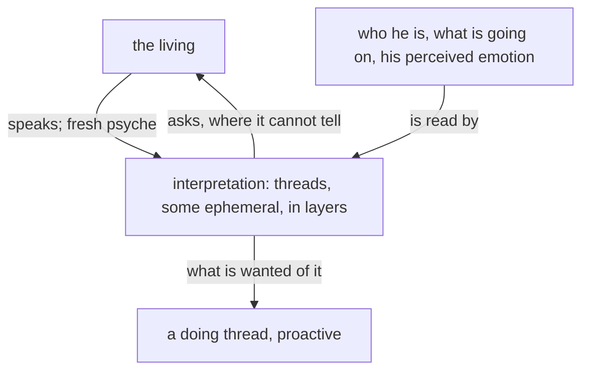

The living does not speak to a doing thread. What he says is taken in by interpretation, a mechanism of one or several threads, some of them ephemeral, which may work in layers.

Interpretation reads fresh psyche against who he is, what is going on, and the emotion perceived in him. It works out what he wants before anything is done, and asks him where it cannot tell.

A doing thread receives from interpretation what is wanted of it, and acts on that at once. Working out what he wants is never the doer's.

