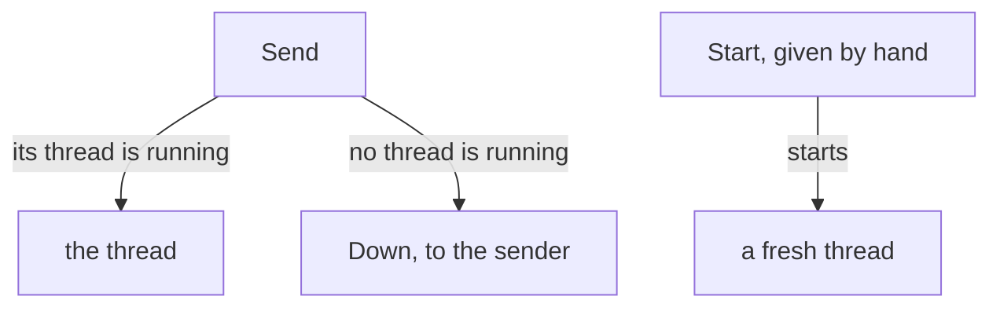

# The Loom

The Loom keeps faculties, starts their threads and carries every message between them.

A faculty (agent) is one power of the machine, at one address. A thread (session) is one run of a faculty; it ends in a crystallization, which starts the next. A fiber (subagent) is one piece of a thread's work; it has no address. A frame is the environment threads run in.

A domain and a role name one faculty, whatever its model: a second model on the same work is another role, named for what it does there.

```datom
[ { Loom Design }
  { Loom DesignAssistant } ]
```

```ethos
Signal
[]
[ Define.Definition
  Amend.{ Faculty Change }
  Send.{ Faculty Request }
  Resolve.Faculty
  Start.Faculty
  Stop.ThreadId ]
[ Defined.Faculty
  Amended.Definition
  Sent.RequestId
  Resolved.Definition
  Started.ThreadId
  Down.Faculty
  Stopped.ThreadId
  Unknown.Faculty
  Taken.Faculty ]
[ Domain.String
  Role.String
  FrameName.String
  Model.String
  HarnessName.String
  ModuleName.String
  ThreadId.String
  RequestId.String
  Faculty.{ Domain Role }
  Definition.{ Faculty FrameName Model HarnessName
               ⟦ModuleName⟧ }
  Change.[ Faculty
           FrameName
           Model
           HarnessName
           Add.ModuleName
           Remove.ModuleName ]
  Request.[ Order.String
            Question.String
            Verbatim.String
            Paraphrased.String
            Notice.String
            Result.{ RequestId String } ] ]
```

A faculty is its definition, one datom, kept in the Matrix; nothing of it is in the Rust.

```ethos
Matrix
[ loom:[ Definition ] ]
[ Definitions.⟦Definition⟧ ]
```

```datom
Define.{ { Nexus Design } Main Fable claude [ vision:loom:0 vision:ethos:0 ] }
Defined.{ Nexus Design }
```

Amend changes one value of a definition alone, its address among them: a renamed faculty keeps its queue, and its next thread starts under the new address. A rename onto an address in use is refused Taken.

```datom
Amend.{ { Nexus Design } Faculty.{ Loom Design } }
Amended.{ { Loom Design } Main Fable claude [ vision:loom:0 vision:ethos:0 ] }
Amend.{ { Loom Design } Model.Opus }
Amended.{ { Loom Design } Main Opus claude [ vision:loom:0 vision:ethos:0 ] }
```

A faculty is reached by its name. Its frame and its model are in its definition, which the Loom answers when asked.

```datom
Send.{ { Loom Design } Question.«Which piece is next?» }
Sent.k7ph
Resolve.{ Loom Design }
Resolved.{ { Loom Design } Main Fable claude [ vision:loom:0 vision:ethos:0 ] }
```

Verbatim carries fresh psyche as it was spoken; Paraphrased carries it rearranged to be clear, in the same voice.

```datom
Send.{ { Ethos Design } Verbatim.«aesthetically I would like when a vector declaration is made to not surround the type inside the vector delimiter by spaces» }
Send.{ { Ethos Design } Paraphrased.«I want a vector's type written against its delimiters, with no spaces, as an Option's is.» }
```

A thread is started by Start alone. A request to a faculty with no running thread is answered Down, and nothing is kept of it.



```datom
Send.{ { Loom Design } Question.«Which piece is next?» }
Down.{ Loom Design }
```

The Loom runs nothing itself: a session is its Harness Nexus's, which also tells it each thread's state; a module is the Pattern Nexus's.

## Tentative, pending the open enum of Ethos version 1

A model is an open enum the user defines, each variant carrying what is its own: its effort, in the levels that model has, or nothing.

```datom
Define.{ { Loom Design } Main Fable.High claude [ vision:loom:0 vision:ethos:0 ] }
```
